# Full House

Full House finds the place down the street your crowd already loves, checks that its crowd loves you back, and sets up one night both owners say yes to.

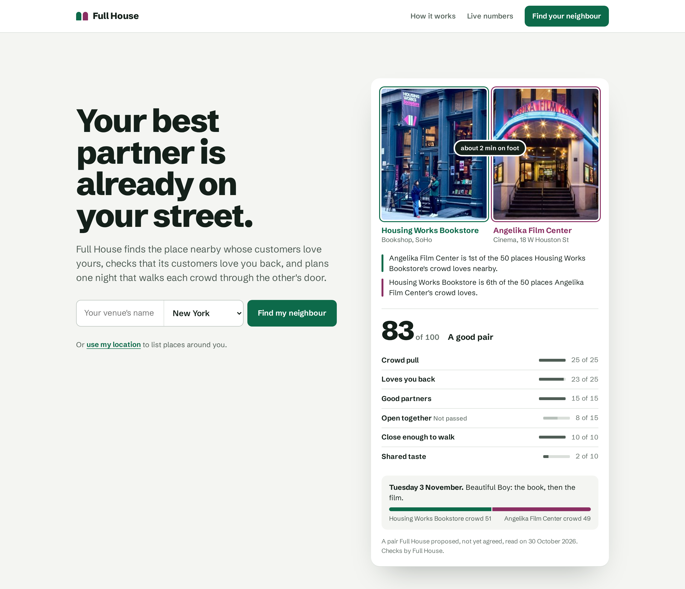

Live site: https://fullhouse.sampark-bhol.workers.dev

Demo video, under three minutes and filmed on the live site: https://youtu.be/W3bhAgIGaXQ

## Why this exists

Every small venue has a dead night. The bookshop is packed on Saturday and empty on Tuesday. The jazz club fills for the late set and nobody comes to the early one. Owners fix this with a neighbour, a reading and then the film down the road, drinks and then the set. Bookshops even run crawls with passport stamps. People already do this by hand.

What you can't see from behind your own counter is which neighbour really shares your crowd. It also has to work both ways. You might love the bar next door, but if its regulars don't care about you, the night flops.

There are a lot of these rooms and most are short of money. Around 800 grassroots music venues trade in the UK and more than half made no profit last year. About two thirds of US independent music venues lost money in 2024. At the same time hundreds of new bookshops opened in the US, and nine in ten English independent bookshops already run events. A night with the right neighbour is one of the few levers a small room has.

We ran the engine on about forty well known independent venues in New York and London. Every one got a partner and just over half got a two way match within ten minutes' walk. So the pairs are there. Nobody was looking at the street from both sides.

Qloo knows what millions of people like, so we asked it the question from each side. Qloo's top pick for Daunt Books in London was a tennis shop. Great taste, wrong room. Full House is the part that judges the list.

## What it does

1. You pick your city and type your venue. Full House reads the street.
2. It names one partner and says why, with a verdict on every place Qloo listed.
3. It plans a night with two stops, one at each place, on a day you are both open.
4. You send the invite link from your phone. The neighbour sets its own part and answers yes or no.
5. Your screen flips on the yes. You check the words and publish an event page, a poster and a calendar file.
6. Each place gets its own sign up link, and every RSVP counts against the link it came through.
7. Every Monday the venue reads its street again and drafts the next night. It waits for you and never publishes on its own.

Any MCP client can run the same flow at `/mcp`. It exposes five tools: find a venue, read the street, propose a night, prepare a night for approval and log turnout.

## How it works

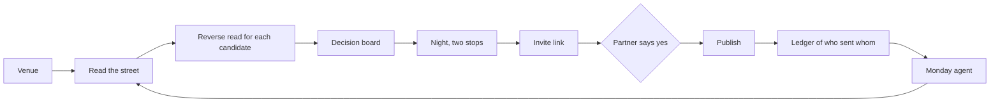

Nothing is typed in. Every number on screen comes from the API at the moment of the request.

| Screen | What it shows |
| --- | --- |
| 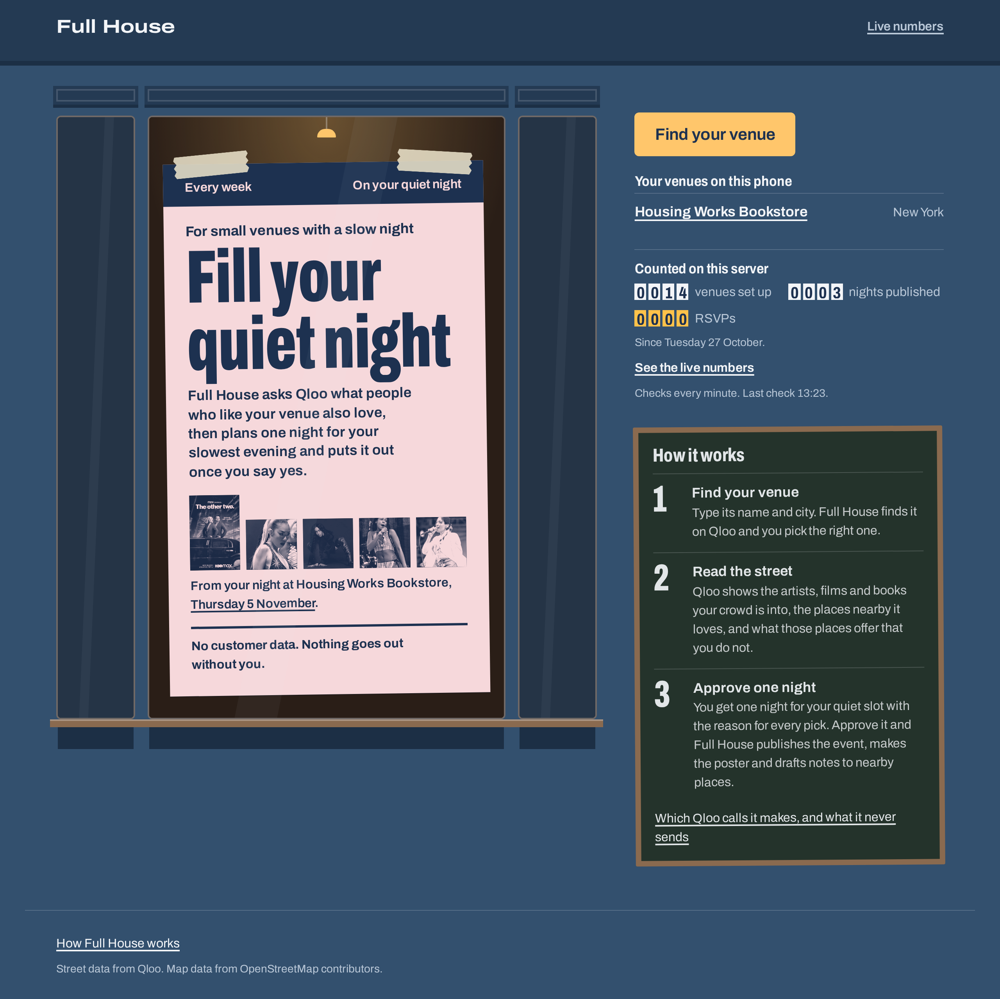 | The landing's board. Qloo's first six places, each judged. |
| 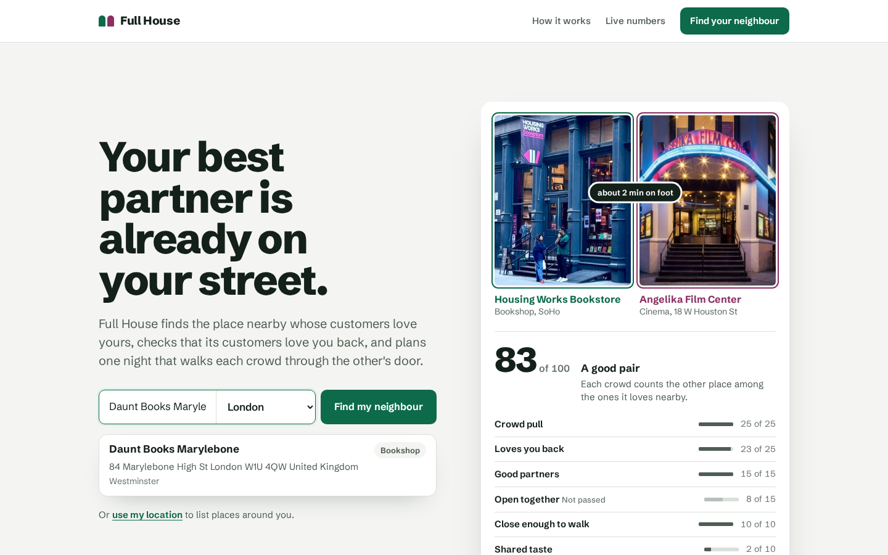 | Searching New York by name. |
| 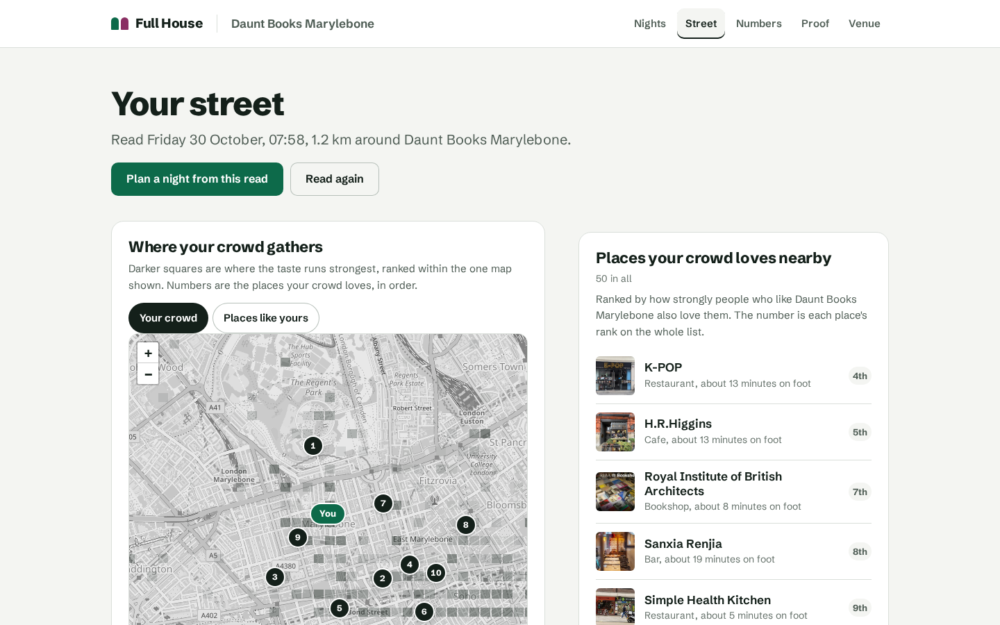 | The Street tab, the crowd's map and its 50 places. |
| 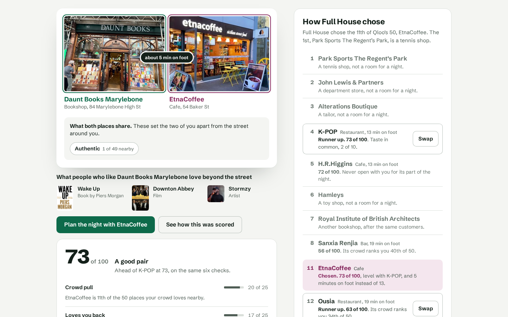 | Angelika chosen at 83 of 100, with the board and the six checks. |
| 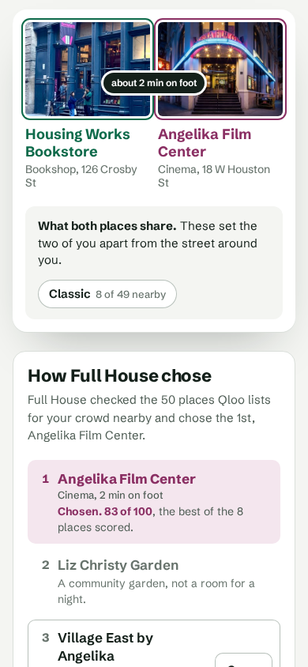 | The same board on a phone. |
| 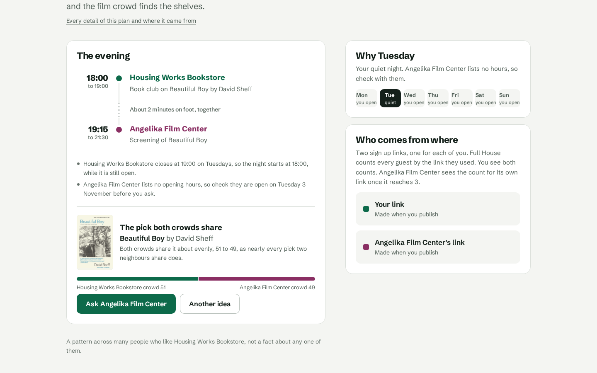 | Book then film, two stops 2 minutes apart. |
| 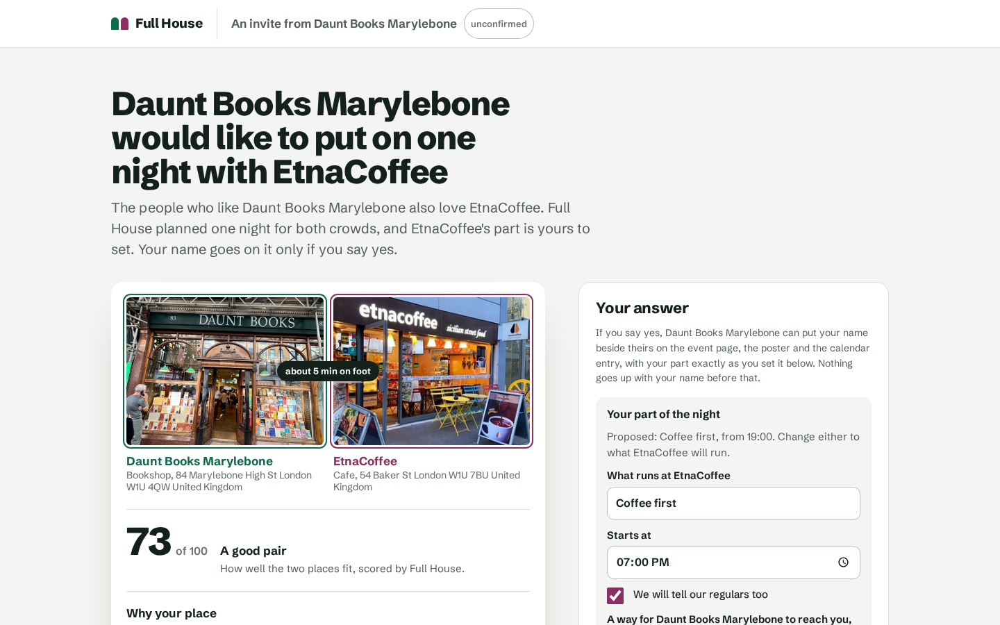 | The invite as Angelika sees it. |
| 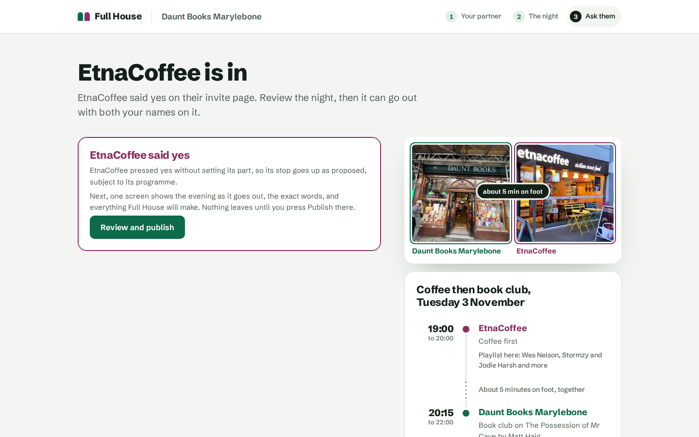 | The owner's screen after the yes. |
| 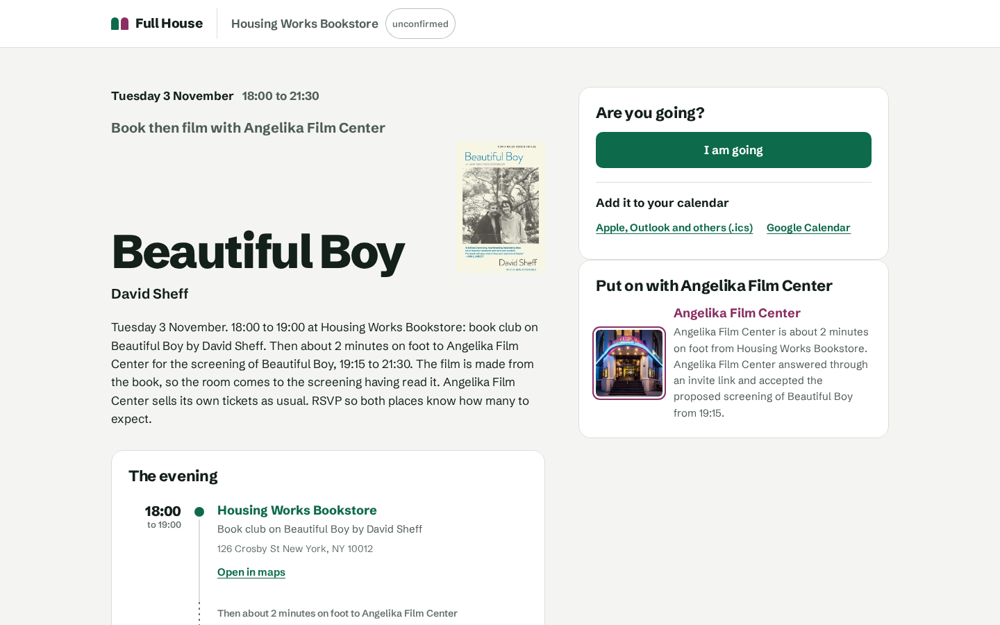 | The public event page. |
| 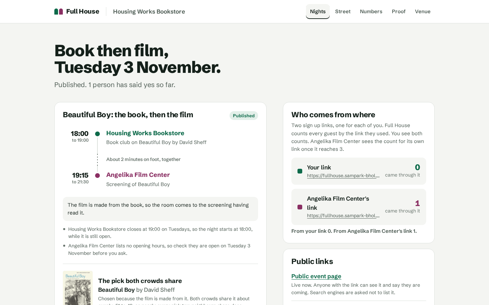 | One RSVP counted against Angelika's link. |

## How a pair is chosen

Qloo returns up to 50 places within 1.2 km that people who like your venue also love. Full House keeps Qloo's order as the rank and sets aside closed places, places that can't host a night (shops, libraries, parks, churches, hotels) and rivals of your own kind. The best 8 of the rest go on.

For each of those 8 it asks Qloo the same question from the other side, with that place as the signal, and looks for your venue in the answer. That is the loves you back read. For Housing Works Bookstore, Angelika is 1st on its list and Housing Works is 6th on Angelika's.

The fit score has six checks and adds to 100. Crowd pull (25) is how high the place sits on your crowd's list. Loves you back (25) is where you sit on theirs. Good partners (15) comes from a complement matrix over nine kinds of place, where a bookshop and a cinema score 1, a cinema and a theatre 0.8, a cafe and a restaurant 0.5 and two of a kind 0. Open together (15) counts the next seven evenings on which both are open, with half credit for a late opening or unlisted hours. Close enough to walk (10) is full within 300 m and empty at 1.5 km. Shared taste (10) scores the tags both places carry by how rare they are on the street, so a tag the whole street carries earns nothing. The highest score wins, unless the next one is within 5 points and a shorter walk.

The partner screen shows the decision board. It lists Qloo's first 15 places plus every place scored, each with a verdict and a reason. For Housing Works the 2nd place is a community garden, the 4th a university library and the 6th a toy shop. Angelika scored 83, Village East 76 and Film Forum 75. The two runners up each have a Swap button.

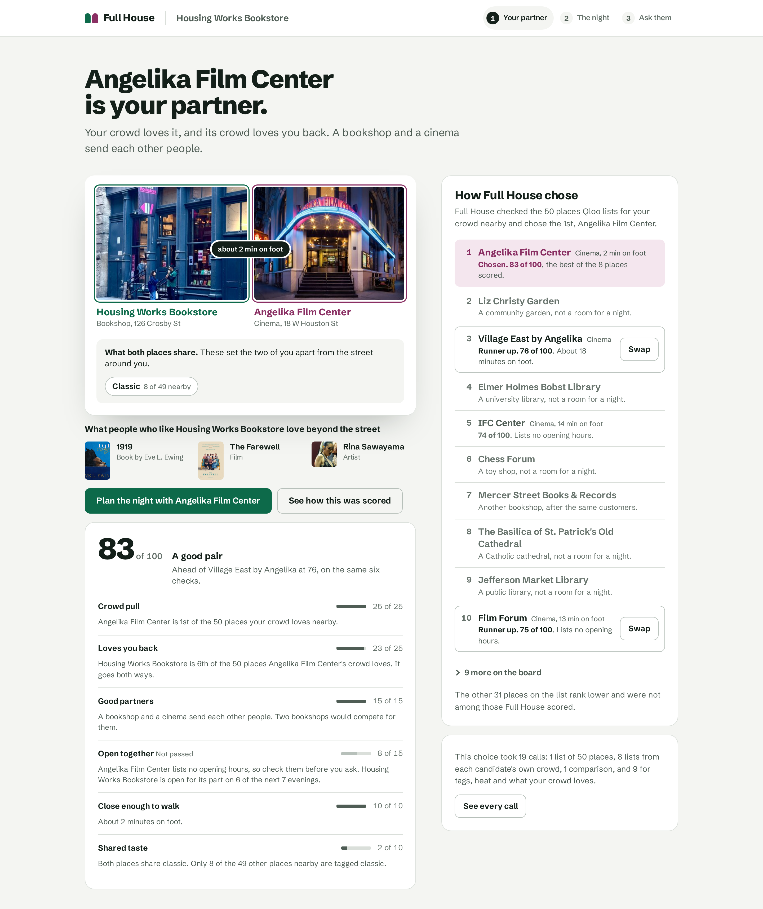

## The night

The two kinds of place pick the format. Book then film, screening then drinks, book club then drinks, a listening party at a record shop, coffee before a live room's own set, a late view at a gallery, a quiz crawl. A film is screened only at a cinema.

The picks come from one Qloo call per kind with both places as the signal and explainability on, so each pick carries each crowd's share. For book then film, Full House finds the book the film was made from. The day is your quiet slot when both places are open, and a stop counts as open only if it stays open 45 minutes after people arrive. Housing Works closes at 19:00 on Tuesdays, so the night starts at 18:00 with a book club on Beautiful Boy, then the screening at Angelika at 19:15.

A small Mistral model on Workers AI writes the event copy from a brief of what Qloo returned. A checker throws out anything that names a place or title that isn't in the brief, and templates step in.

## The agent

Every Monday at 09:00 in the venue's own time zone, a Durable Object alarm wakes the venue. It reads the street again, checks whether last week's partner is still the best fit, leaves out formats already run with that partner, drafts a night and holds it for you. The owner screen shows the run as a timeline with the time, the step, the outcome and the Qloo calls each step made. "Run it now" starts the same routine once an hour.

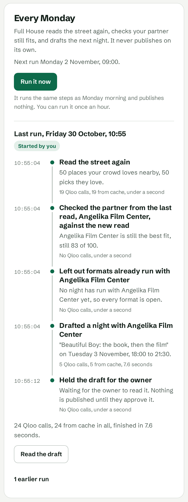

## What Qloo provides

Only the Worker holds the key. The limits are in `src/shared/engine.ts`. Qloo supplies the lists and the shares. The verdicts, the six checks, the matrix, the format grammar, the scheduler and the ledger are Full House's own.

| Step | Request | Calls |
| --- | --- | --- |
| Find the venue | `/search` | 1 to 3 per search |
| The street's and the venue's tags | `/v2/insights`, `urn:tag` | 2 per read |
| Places the crowd loves | `/v2/insights`, `urn:entity:place`, take 50 | 1 per read |
| Loves you back | the same, each candidate as signal | up to 8 per read |
| What the two share | `/v2/analysis/compare` | 1 per read or swap |
| Where the crowd gathers | `/v2/insights`, `urn:heatmap` | up to 2 per read |
| What the crowd loves | `/v2/insights`, five kinds | 5 per read |
| The night's picks | `/v2/insights`, both places | 1 to 3 per night |
| The book behind the film | `/search` | up to 3 per night |

A read makes at most 19 calls under a cap of 30, and a night stays under a cap of 8. At most three go out at once and answers are kept for a day.

## One read, request by request

This is the read for Housing Works Bookstore in New York, from answers Qloo's hackathon API gave on a real run. Every call is a GET to `https://hackathon.api.qloo.com` with the key in the `X-Api-Key` header, which never appears in the app, the call list or here. `<venue>` is Qloo's own id for Housing Works, `<candidate>` the id of a place under test and `<point>` the venue's map point.

| # | Request | What Full House used | Decision |
| --- | --- | --- | --- |
| search | `/search` `query=Housing Works Bookstore Cafe`, `types=urn:entity:place`, `filter.location=40.7128,-74.006`, `filter.radius=8`, `take=20` | 20 places, Housing Works at 126 Crosby St first | A venue is set up only when a second search by the listing's name returns the same id first. |
| 1 | `/v2/insights` `filter.type=urn:tag`, `signal.location=<point>`, `diversify.by=subtype`, `take=25` | 25 street tags, led by Intimate, Social, Unique | The baseline that makes a shared tag mean something. |
| 2 | the same with `signal.interests.entities=<venue>`, `take=40` | 40 venue tags, place genres Bar and Book store first | Menu tags are dropped. The two genres feed call 13. |
| 3 | `/v2/insights` `filter.type=urn:entity:place`, `signal.interests.entities=<venue>`, `filter.exclude.entities=<venue>`, `filter.location=<point>`, `filter.location.radius=1200`, `feature.explainability=true`, `take=50` | 50 places, Angelika 1st at 0.977, 153 m away | Qloo's rank. The board judges every row and 8 candidates go on. |
| 4 | `/v2/insights` `filter.type=urn:heatmap`, `signal.interests.entities=<venue>`, `filter.location.radius=2000` | 526 squares, the strongest under the shop itself | Draws the map on the Street tab. |
| 5 to 12 | as call 3 with `signal.interests.entities=<candidate>`, no explainability | Housing Works on each list. Angelika 6th, Village East 9th, Film Forum 11th, IFC Center 15th, Lovers of Today 17th, Roxy 18th, Anthology 22nd, The Greene Space 29th | Loves you back is 25 times 1 minus (rank minus 1) over 50, so Angelika earns 23 of 25. The invite shows Angelika its own first five from this answer. |
| 13 | `urn:heatmap` with `signal.interests.tags=restaurant:bar,book_store`, `operator.signal.interests.tags=union` | 641 squares | The map's second layer, "Places like yours". |
| 14 to 18 | `/v2/insights` `filter.type` artist, book, movie, podcast, tv_show, `signal.interests.entities=<venue>`, `signal.location=<point>`, explainability on, `take=10` | First of each, Rina Sawayama, 1919 by Eve L. Ewing, The Farewell, 2 Dope Queens, The Other Two | One of each goes under the pair, the lists to the Street tab. |
| 19 | `/v2/analysis/compare` with `a.signal.interests.entities=<venue>`, `b.signal.interests.entities=<Angelika>`, `take=20` | One shared tag, "Place", which says nothing | The pair is scored again and the higher score is kept. Here nothing changes. |
| 20, 21 | `/v2/insights` `filter.type=urn:entity:book` then `urn:entity:movie`, `signal.interests.entities=<venue>,<Angelika>`, explainability on, `take=10` | Books lean to Housing Works, 1919 at 61 to 39. Films run near even, Beautiful Boy among them | Only films filed as based on a book qualify. Three do. |
| 22 to 24 | `/search` `query=Beautiful Boy`, then `If Beale Street Could Talk`, then `The Hate U Give`, `types=urn:entity:book`, `take=3` | The book behind each film, David Sheff's for Beautiful Boy | Beautiful Boy is the best known, so it is the pick, split 51 to 49. |

The tag calls list five tag types for the street and eight for the venue, which this table shortens. After the calls, nothing goes out until Angelika says yes on its invite page.

## Run it

Node 22.18 or newer.

```sh
npm ci
npm run dev
```

This runs the Worker with `wrangler dev` against a fake Qloo server. For live data:

```sh
read -rs QLOO_API_KEY && export QLOO_API_KEY
LIVE=1 npm run dev
```

The key goes into a `.dev.vars` that is deleted on exit. To deploy, run `npm run build` and `npx wrangler deploy`, and set `QLOO_API_KEY` and `TOKEN_SECRET` as secrets.

## Tests

```sh
npm run check
npm run e2e
```

`check` runs the typecheck and the unit tests, whose fixtures include trimmed real Qloo answers. `e2e` runs Playwright against the fake Qloo server. A run today of `npx vitest run --maxWorkers=2` passed 648 tests in 88 files, and `npm run e2e` passed 42 tests in the app project and 1 in the no key project.

## Privacy

Qloo receives your venue as a public place, ids it returned itself, names typed into search, and on the Proof tab the places a plain language model suggested, only to check they exist. Nothing about customers is sent. A position from "use my location" is never stored.

A partner is never named on a night's event page, poster or calendar file before it says yes on its own invite page. The partner sets its own part first, what runs there, when, and whether it is open. The public page says how the yes was given, for example "Angelika Film Center answered through an invite link and accepted the proposed screening of Beautiful Boy from 19:15." You approve every night, and the Monday run never publishes.

On the hosted demo email is off, so venues show as unconfirmed.

A venue nobody opens for 8 weeks stops its Monday runs and is deleted after 6 months.

## Known limitations

The neighbour's yes comes through an invite link. Email is off on the hosted demo, so a venue can't prove it owns its page yet, and every venue shows as unconfirmed.

Some places, cinemas especially, list no opening hours in Qloo. Full House says so and asks the owner to check instead of guessing.

Taste data is thinner away from big US and European cities, so pairs there come out weaker.

No real night has run yet. The ledger counts sign ups by the link they came through, not people through the door.

In the demo video the neighbour's phone is played by us.

## Sources

- https://www.musicweek.com/public_html/index.php/live/read/music-venue-trust-175-towns-cities-with-grassroots-venues-no-longer-receive-regular-touring-shows/093415
- https://www.vip-booking.com/news/ReadNews/General/8832/study-64-of-us-independent-venues-lost-money-in-2024
- https://shelf-awareness.com/theshelf/2026-05-29/the_aba_annual_meeting_community_forum:_celebrating_a_challenging_banner_year.html
- https://www.booksellers.org.uk/industryinfo/industryinfo/latestnews/Independent-bookshops-are-a-vital-part-of-England%E2%80%99

## Licence

MIT. See `LICENSE`.
