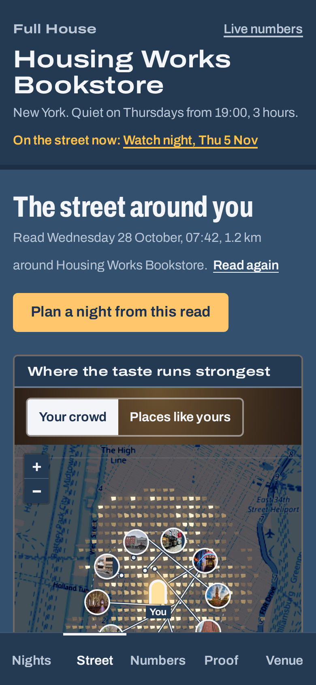
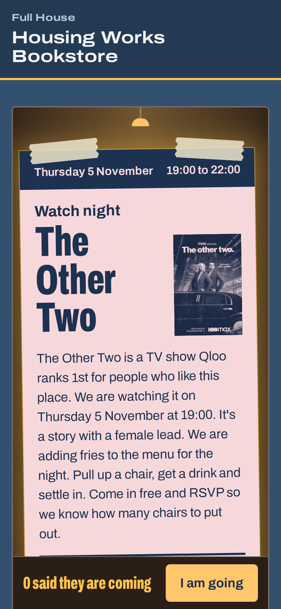
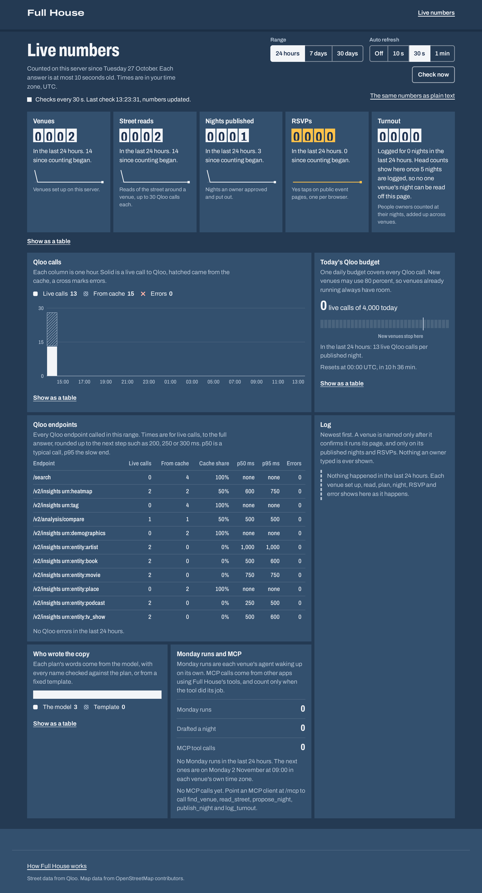
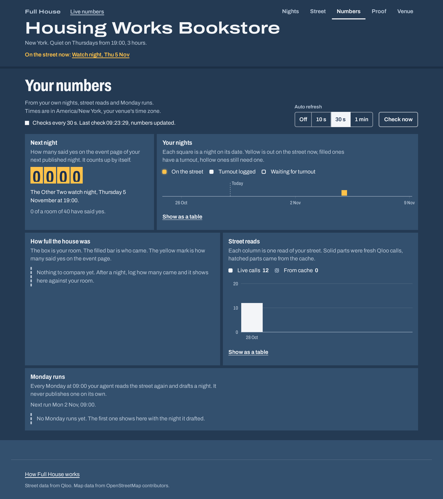

# Full House

Full House fills a small venue's quiet night, every week. It reads what the street around a cafe, bookshop, bar or gallery loves from Qloo, plans one night for the slow slot with the reason beside every pick, and puts the night out after one yes from the owner.

- Live app: https://fullhouse.sampark-bhol.workers.dev
- Live numbers: https://fullhouse.sampark-bhol.workers.dev/live
- MCP endpoint: https://fullhouse.sampark-bhol.workers.dev/mcp

## Why I built it

Every independent venue has a night that dies. Tuesday at the bookshop cafe, Wednesday at the bar on the corner. The owner knows exactly which one, and the usual fixes are a discount or another reel. What fills a room is a night the people nearby already care about, run with places they already go to. Someone working the counter cannot see either of those. There is no booker, no marketing person and no spare hour.

Qloo can see both. It knows, in aggregate, which films, artists, books and podcasts the people who like one particular venue are into, and which places nearby they also love. I wanted that in the hands of the person who has to fill the chairs on Thursday, as one plan they can read and approve in a minute.

## Who pays

The buyer is the owner of an independent cafe, bar, bookshop, record shop, brewery or gallery with one slow night a week and nobody to plan it. Toast's 2025 Voice of the Restaurant Industry survey had 46 percent of operators calling advertising moderately or extremely challenging, and r/smallbusiness has a post like "I've been open for four hours and have only sold two ice creams" most weeks.

The plan is about 99 dollars a month per venue, so 500 venues is about 500,000 dollars a year. One weekly run costs 12 Qloo calls for the read and two Workers AI calls for the copy on the Workers Free plan; a refine adds one more model call. The first 100 venues would be reached by hand: walking into shops on streets where Qloo's data is dense, showing the owner their own street read on a phone, and leaving a printed flyer for their quiet night. There are no paying venues or pilots yet.

## What it does

1. **Finds your venue.** Type the name and the city. Full House asks Qloo for matching places, drops namesakes in other countries once your city has a match, and you pick yours by its address. Then you say which night is quiet, when it starts and how many people fit.
2. **Reads the street.** Twelve Qloo calls: the taste of the blocks around you, the taste of your own audience, the places within 1.2 km your audience loves, two heat maps, what your audience loves in five kinds of culture, how it leans by age and gender in aggregate, and what the places it loves have that you do not.
3. **Plans one night.** Plain rules turn the read into a film, listening, quiz, book, podcast or tasting night for your quiet slot, at least two days out so partners and guests get notice: a feature, two or three partners within a 1 km walk that Qloo lists as open that night, menu ideas from your own audience's food tags and a playlist of artists. A kind of night that answers a gap the read found gets the edge, so cinemas nearby and none here lead to a film night. Two alternatives in other formats and with other features sit beside it. Every line carries its reason and the number of the Qloo call it came from.
4. **Takes changes in your words.** "Make it Friday, no live music, under 40 people." The model turns the request into plan settings through a tool call with a strict schema. If that fails, a keyword parser does it.
5. **Acts after one yes.** One screen shows the exact words that will go out, which you can change, and lists everything that will happen: a public event page with an RSVP counter, a printable A4 poster with a QR code, a calendar file and a Google Calendar link, a note to each partner drafted in your own mail app, the Eventbrite event if you connected Eventbrite and tick it, and the links emailed to you. Untick anything you do not want. Nothing leaves before you press Publish, and any page can be taken down later.
6. **Learns from the night.** Afterwards you log how many people came, and the page says what next Monday will do with it.
7. **Comes back every Monday** with a fresh read and a new night, leaves out what you already ran, and waits for your yes.

For Housing Works Bookstore Cafe on Crosby Street in SoHo, the live read planned a watch night around The Other Two, the TV show Qloo ranks first for people who like the shop and Angelika Film Center nearby. The partners are IFC Center, Roxy Cinema New York and Film Forum, each 10 or 11 minutes away on foot. Three of the five places its audience loves nearby are cinemas, and the bookshop is not one. The read shows that under "Found nearby, not here", and that gap is why the night is a screen night. City Lights Booksellers in San Francisco got a book night around 1919. The Photographers' Gallery in London got a book night around Wake Up, with a watch night around It's a Sin as an alternative.

| The landing page | The night, on the venue's own flyer |
| --- | --- |
|  |  |
| **The street read** | **The public event page** |
|  |  |
| **Live numbers for the whole server** | **The venue's own numbers** |
|  |  |

Every screenshot is from the live site on 29 October 2026.

## How Qloo powers each step

Here is the Housing Works read, call by call, from the live hackathon API on 27 October 2026. Calls 1 to 5 and 7 go out together, then compare, the second heat map and the five picks calls, which need the places from step 4. Every request is a GET to `https://hackathon.api.qloo.com` with the key in the `X-Api-Key` header, which never appears in the app. `<venue>` is Housing Works' Qloo id, `36B3A5EB-BE3D-4470-ACDC-F9B2FF54EA43`, and `<point>` is `POINT(-73.996575 40.724604)`, longitude first as insights expects.

1. **Find the venue.** `/search?query=Housing Works Bookstore Cafe New York&types=urn:entity:place&take=8`. Eight hits. Housing Works Bookstore at 126 Crosby St comes first with 82 tags. A New York Café in Budapest is dropped because the city already has a match, so the owner picks from seven addresses. One search with the city in the query found all 15 venues I tested. Looking the city up first sent "New York" to the middle of New York State.
2. **The street's taste.** `/v2/insights?filter.type=urn:tag&signal.location=<point>&filter.tag.types=urn:tag:genre:place,urn:tag:ambience:qloo,urn:tag:specialty_dish:place,urn:tag:genre:media,urn:tag:genre:music&diversify.by=subtype&diversify.take=5&take=25`. 25 tags, five per namespace: Intimate, Social, Unique, Brunch, Cocktail Bar, Sandwich, Essays, soul. Their scores sit between 0.989 and 1.000, so the app shows them as a set, not a ranking.
3. **Your audience's taste.** The same call with `signal.interests.entities=<venue>` instead of the location, three more namespaces (`keyword:media`, `cuisine:qloo`, `good_for:qloo`) and `take=40`. 40 tags with a real spread: Fries, Avocado Toast, folk, indie rock, LGBT, Book store, Cozy.
4. **Places your audience loves.** `/v2/insights?filter.type=urn:entity:place&filter.location=<point>&filter.location.radius=1200&signal.interests.entities=<venue>&filter.exclude.entities=<venue>&feature.explainability=true&take=30`. 30 places, every one tied to the venue by explainability: Angelika Film Center, IFC Center, Chess Forum, Mercer Street Books & Records, Film Forum. The ten strongest are numbered on the map.
5. **Two heat maps.** `/v2/insights?filter.type=urn:heatmap&filter.location=<point>&filter.location.radius=2000&signal.interests.entities=<venue>` gave 526 squares of about 150 m, the strongest about 40 m from the shop. The second map signals with the shop's own two kinds of place from step 3 through `signal.interests.tags=...&operator.signal.interests.tags=union`, and gave 641 squares showing where places like it run strongest.
6. **What your audience loves.** `/v2/insights?filter.type=urn:entity:artist&signal.interests.entities=<venue>,<two places from step 4>&signal.location=<point>&feature.explainability=true&take=10`, then the same for `book`, `movie`, `tv_show` and `podcast`. The two places are the first loved places that host people, here Angelika Film Center and Village East by Angelika. Qloo's `warnings` said it could not use Village East for any type, and the read says so. Every pick shows its explainability share, such as Housing Works 0.61 and Angelika 0.39 for Rina Sawayama: Rina Sawayama, Kelsey Lu and Princess Nokia; 1919 and Friday Black; The Other Two and Shrill; 2 Dope Queens and Las Culturistas. The features of nights run in the last eight weeks go in `filter.exclude.entities`, so the Monday run brings new ones.
7. **Your audience in aggregate.** `/v2/insights?filter.type=urn:demographics&signal.interests.entities=<venue>`. The owner reads "People who like Housing Works Bookstore on Qloo over index on the 55 and older and 35 to 44 age groups", with a line saying it describes an audience, not any person.
8. **Where you differ.** `/v2/analysis/compare?a.signal.interests.entities=<venue>&b.signal.interests.entities=<five places from step 4 that host people>&take=20`. Landmarks, gardens and alleys are left out, because they cannot carry a gap a venue could act on. The shared list holds only Place and LGBTQ+ friendly. The useful part is the places' side minus the venue's side: Movie Theater and Food on three of the five, Arcade games on two, none of them on Housing Works.
9. **The night.** No Qloo call. Movie Theater from step 8 gives film nights the edge, and the planner takes the top TV show. It keeps partners within a 1 km walk whose tags fit a film night, drops 9 nearby places that Qloo's hours show closed by 19:00 on Thursday, says where Qloo has no hours, and skips Angelika, the nearest cinema at 150 m, because Qloo files it as a cafe and event venue too, the same kind of place as Housing Works. The menu ideas are the audience's own food tags from step 3: fries, salad, toast.
10. **Proof.** The Proof tab asks a plain model the question an owner would type into a chatbot, then looks up every place it names with `/search?query=<name>&types=urn:entity:place&filter.location=40.724604,-73.996575&filter.radius=10&take=5` (artists with `types=urn:entity:artist`, other names with no type). A name the artist search misses is searched again across the whole catalog, so an author comes back as an author. Places Qloo lists as permanently closed count as not found, and the name the model gave the night itself is not checked. Full House's own feature and partners are checked by id in one `/entities?entity_ids=...` call. Then every name found is looked for in the read: among the places nearby Qloo ties to the shop's audience, or among its picks. For Housing Works, IFC Center is 5th among the places nearby people who like the shop love, and the tab prints that line for every name on both sides.

### Why this needs Qloo

Before building the read I probed the live API on 15 venues in 11 cities. With only a location as the signal, Qloo's answers go flat: the artist, book, film, show and podcast picks all scored between 0.757 and 0.765, nothing was explained, and the same global stars came back almost everywhere. With the venue's own entity in the signal, the lists split apart: 15 different first artists for 15 venues, and a per result explanation on 79 of 90 of those lists.

That link, from a bookshop on Crosby Street to the films its visitors watch and the cinemas they walk to, is the whole product. A review site knows ratings, a map knows distances, Eventbrite knows events, and a chatbot knows what was on the internet when it was trained. None of them can say what the people who like this one venue also love, nearby and across film, music, books and podcasts, with a reason for each pick. Without that, the night is a guess.

## The Monday agent

Each venue is its own Durable Object with an alarm set for Monday 09:00 in the venue's time zone. When it wakes, it:

1. Reads the street again with the same twelve calls.
2. Sends the features of the last eight weeks of nights to Qloo as exclusions, so the picks are new, and notes how each pick moved since last week's read, with both dates ("#2 in this read, #4 in the read of 2026-10-20"). It makes no claim of momentum, because Qloo's weekly trend data held flat on this host.
3. Plans the next quiet slot. If the last night drew under 40 percent of its room, that kind of night is skipped this week; if it filled 60 percent or more, that kind is preferred.
4. Stores the plan as a proposal from the Monday run, emails the owner a link if they confirmed an email, and sets next Monday's alarm.

A venue nobody opens for 8 weeks stops its Monday runs, and after 6 months it is deleted with everything in it.

It never publishes. The owner approves every night.

## MCP tools

`/mcp` is a stateless Streamable HTTP endpoint with JSON responses, built on the MCP TypeScript SDK v2. Any MCP client can run the whole flow. Owner tools take the `venue_id` and `owner_token` from the owner's link.

| Tool | What it does | Owner token |
| --- | --- | --- |
| `find_venue` | Looks a venue up by name and city and returns up to 8 places with address, coordinates and tags | no |
| `read_street` | Runs or refreshes the street read, every part with its Qloo provenance | yes |
| `propose_night` | Drafts a night plus two alternatives, or refines a plan from a request in plain words. Publishes nothing | yes |
| `publish_night` | Publishes nothing. Returns the link to the approval screen, where the owner reads the words and ticks each action | yes |
| `log_turnout` | Records how many people came, with an optional note. Never sent to Qloo | yes |

## Live numbers

- Charts: https://fullhouse.sampark-bhol.workers.dev/live
- The same numbers as plain text, no JavaScript needed: https://fullhouse.sampark-bhol.workers.dev/live.txt

`/live` shows what this server has done: venues set up, street reads, plans and who wrote their words, nights published, RSVPs, turnout, Monday runs, MCP tool calls, and every Qloo call by endpoint with its cache answers, errors and time to answer. Every figure comes from counters the Worker keeps as things happen. Nothing is seeded. A pane with nothing to count says what will show there once someone uses the app. Each chart covers 24 hours, 7 days or 30 days, opens as a table, and checks for new numbers on its own while the tab is open.

The page keeps each owner's business with the owner. A venue is named only after it confirms an email on its own website's domain, and then only on its published nights and RSVPs. Reads, plans and drafts never carry a name. Head counts and seats show only as a total, and only once five nights are logged in the range, so no one venue's night can be read off the page. Taking a night down removes its lines from the log, and deleting a venue removes all of them.

Each owner also has a Numbers tab behind their owner link: the RSVPs for the next night as they come in, every night against its room, each street read with the Qloo calls it made, and what each Monday run drafted.

## Privacy and safe use

- **What Qloo receives:** the venue as a public place (its Qloo id and map point), ids of places and tags that Qloo itself returned, the names typed into a search, and, on the Proof tab, the names a plain language model suggested, sent to Qloo search only to check whether they exist. Nothing about customers, because Full House never asks for anything about them. The owner's email stays in the venue's Durable Object. RSVPs and turnout reach the public numbers only as counts added up across venues, and never reach Qloo.
- **Who posted a page:** until a venue confirms an email on its own website domain, its event page and poster say "Posted on Full House by whoever set up the venue. The venue has not confirmed it." Anyone can report a page, three reports take it offline, and the owner can take any page down.
- **Aggregate, and said so:** every screen with Qloo data ends with a "Receipts" drawer that holds a "What this does not tell you" list. Demographics describe the venue's audience on Qloo, never the street's residents or any person. Ranks are positions within one answer, never percentages, and a missing score is never shown as zero.
- **Qloo's answer and Full House's choice stay apart:** each page has one "Receipts" drawer, closed until opened, that says how each part is known and lists each reason with the Qloo call it came from. Where a rule of mine made the choice, the line says so ("tagged movie theater, which Full House pairs with a film night").
- **The model writes words, not facts:** plain rules pick the night. The model (Mistral Small 3.1 24B on Workers AI by default) gets a JSON brief of what Qloo returned and writes the description, poster lines, social post and partner note. A checker rejects any copy that names a person, place, work or brand that is not in the brief, fixed templates step in, and the plan says which writer was used.
- **No outreach without the owner:** partner notes open in the owner's own mail app, Gmail or Outlook, unsent. The only email the app sends goes to an address the owner confirmed, at most three a day, and only when email is set up.
- **Images without tracking:** covers and place photos come from Qloo's image host through the Worker's own `/img/` path, so a visitor's browser never talks to Qloo.
- **Public pages stay small:** event pages ask search engines not to list them and keep an RSVP count only. One RSVP per browser, through a random cookie stored as a hash salted with the night, and at most three per night from one address.
- **Owner links can be replaced:** a new owner link from the venue page stops every older one for that venue.
- **How long things are kept:** a venue nobody opens for 8 weeks stops its Monday runs; after 6 months it is deleted with everything in it.
- **Licences:** the playlist is a list of artists, not a licence, and film nights carry a screening licence reminder.
- **Deleting a venue** removes its reads, plans, nights, counts, email and Eventbrite token and its lines in the public log, and its event pages stop working. The totals on `/live` keep what was counted, with no name attached.

## Limits

- Qloo's weekly trend series came back flat or empty on the hackathon host, so nothing is called rising. Changes show only as rank moves between two dated reads.
- Street tags from a location arrive nearly level and in five namespaces only, so they are shown as a set.
- Demographics ignore location, so they describe the venue's audience as a whole, never the street.
- The venue has to be in Qloo's catalog with a location. Search is fuzzy and never comes back empty, which is why the owner picks by address.
- For a few venues Qloo silently drops the venue from the signal for some kinds of pick. The read spots this from the empty explainability and labels those lists as the area's picks.
- Data is densest in Manhattan, London, Paris and San Francisco and thinner in Austin, Chicago, Los Angeles and Berlin.
- A plan is a suggestion from aggregate taste. It says nothing about who will come, and the owner should check a partner fits before sending the note.
- Qloo calls are capped per day (`QLOO_DAILY_BUDGET`, 4000 by default, with a fifth kept for venues older than a week) and per read (30). Each IP address, or IPv6 /64, gets 20 new venues, 120 searches, 30 reads, 60 plans, 60 RSVPs and 10 proof checks a day, and each venue 3 fresh reads a day. `/mcp` takes 60 requests a minute from one address, and `/api/stats` and `/live.txt` take 30.
- The Eventbrite step is covered by tests against a stubbed Eventbrite API. I have not run it against a live Eventbrite account yet.

## Run it locally

Node 22.18 or newer on Linux or macOS.

```sh
npm ci
npm run dev
```

This builds the web app, starts a fake Qloo server that answers in Qloo's shapes, and runs the Worker with `wrangler dev`. It prints the local URL. Ctrl+C stops everything.

On live Qloo data, keep the key out of your shell history:

```sh
read -rs QLOO_API_KEY && export QLOO_API_KEY
LIVE=1 npm run dev
```

The script writes the key to a `.dev.vars` only you can read and deletes it when it stops. With `CLOUDFLARE_API_TOKEN` set, the Workers AI binding runs remotely. Without it, plans use template copy.

## Test

```sh
npm run check   # typecheck and unit tests
npm run build   # web app into web/dist
npm run e2e     # Playwright, headless, against wrangler dev and the fake Qloo server
```

Unit test fixtures are small hand written JSON shaped like Qloo's answers. The end to end run starts the Worker without the AI binding, so plans use templates, then restarts it without a key to check the page that says so. On 27 October 2026 all 341 unit tests and all 20 end to end specs passed, plus the key missing spec.

`npm run probe` and `npm run live-read` run against the live API with `QLOO_API_KEY` set. They keep every raw answer in `../raw/live/`, beside the clone, so no Qloo response ever lands in the repository.

## Deploy for free on Cloudflare

```sh
npm ci
npm run build
npx wrangler login
npx wrangler deploy
npx wrangler secret put QLOO_API_KEY
openssl rand -hex 32 | npx wrangler secret put TOKEN_SECRET
curl https://fullhouse.<subdomain>.workers.dev/api/health
```

For the owner email, also set `RESEND_API_KEY` and `RESEND_FROM` (a sender on a domain you verified with Resend). Without both, email stays off.

The Workers Free plan covers it: SQLite Durable Objects, the Cache API and a daily Workers AI allowance are included. The dry run bundle is 1646.04 KiB, 397.58 KiB gzipped. A street read stays well inside the 50 subrequests a free invocation gets: 12 Qloo calls and at most 10 Cache API operations.

## Security

The Qloo key lives only in the Worker secret and travels only in the request header. It never reaches the browser, a log line, a response body or the call list the owner sees. Owner links carry an HMAC token after the `#`, compared in constant time. Eventbrite tokens are sealed with AES-GCM under a key derived from `TOKEN_SECRET` and never returned. The API and the MCP endpoint refuse writes from any other origin, bodies are capped at 64 KB, limits are counted under a salted hash of the caller's IP address, and API and event page responses carry strict security headers. Server rendered pages escape every user string.

To report a vulnerability, use GitHub private vulnerability reporting on this repository: Security tab, then "Report a vulnerability". Details are in `SECURITY.md`.

## Repository map

| Path | What it is |
| --- | --- |
| `src/shared` | Types, words, distance and the turnout rule every layer shares, and the colour tokens |
| `src/core/qloo` | Qloo client: request builder, retries, cache and budget hooks, parsers, provenance |
| `src/core/street` | The street read, one step per Qloo call, with reasons and limit lines |
| `src/core/planner` | Night formats, scoring, partners, menu ideas, playlist, slot dates |
| `src/core/copy` | Brief, prompt, claim checker, templates, owner edits |
| `src/core/refine` | Turning a change request in plain words into plan settings |
| `src/core/baseline` | The Proof tab: the plain model ask and the name checks against Qloo search |
| `src/worker` | Hono app, routes, owner tokens, meter, MCP server, Workers AI adapter |
| `src/worker/qloo` | Qloo caches, budget and error mapping for the Worker |
| `src/worker/qr` | The QR encoder for the poster |
| `src/worker/venue` | The venue's Durable Object: records, planning, publishing, the Monday run |
| `src/worker/stats` | The live numbers: counters, Qloo call times, the public log and the owner's Numbers tab |
| `src/worker/actions` | Event page, calendar file, mail drafts, Eventbrite, owner email |
| `src/worker/pages` | Server rendered event page and poster |
| `web/src` | The owner app: pages, UI pieces and styles |
| `test` | Unit tests and hand written fixtures |
| `e2e` | Fake Qloo server and Playwright specs |
| `scripts` | Local dev and e2e runners, the live probe and the live read |
| `media` | The screenshots in this README: the Housing Works plan, read from the live Qloo API on 27 October 2026 |

## Licence

MIT. See `LICENSE`.
